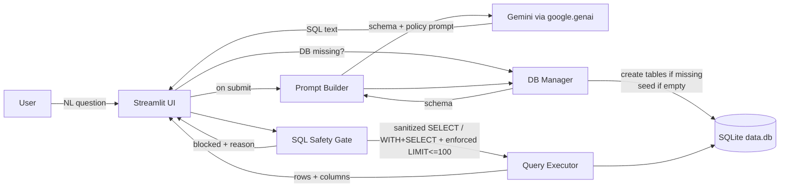

# IntelliSQL Architecture (As Is) & Target Architecture (Proposed)

**Status:** Proposal for human review. This document describes the current IntelliSQL architecture (as verified in the repository) and a proposed design to implement the approved enhancements. It does not claim that the proposed components are already implemented.

---

## 1. Existing architecture (verified)

### 1.1 Components

- **Streamlit UI app** in `app.py`
  - Pages: Home, About, Intelligent Query Assistance
  - Input: user types a natural-language question
  - Output: generated SQL string and a result table

- **Gemini integration (via `google.genai`)**
  - Client: `genai.Client(api_key=os.getenv("GOOGLE_API_KEY"))`
  - Model: `gemini-2.5-flash`
  - Prompt: hard-coded to a single table named `STUDENTS` with columns `NAME`, `CLASS`, `Marks`, `Company` (note casing/mismatch described below)

- **SQLite data store**
  - Database file: `data.db`
  - Query execution: `sqlite3.connect("data.db") -> cursor.execute(sql)`
  - Results: `fetchall()`
  - Minimal sanitization: removes ```sql markdown fences from LLM output

- **DB bootstrap script** in `sql.py`
  - Creates table `Students` and inserts sample rows
  - Not idempotent (no `CREATE TABLE IF NOT EXISTS`), so running twice typically fails

- **Configuration**
  - Env loading: `dotenv.load_dotenv()`
  - API key: `GOOGLE_API_KEY` (`.env` is ignored by git)

### 1.2 Verified technology stack

- Python
- Streamlit
- SQLite (built-in `sqlite3` module)
- Google Gemini (via `google.genai`)
- python-dotenv

### 1.3 Current data flow (as-is)

1. User types a natural-language question in Streamlit.
2. App calls Gemini with `[constant prompt, user question]`.
3. Gemini returns text, which is treated as SQL (stripped of markdown fences).
4. App executes the SQL on `data.db`.
5. App renders returned rows as a table.

### 1.4 Identified limitations / risks (verified from code paths)

> These directly impact usability, reliability, cost, and security.

- **Database first-run failure**
  - `data.db` is ignored by git and not provisioned by the app.
  - A fresh clone will error on query execution unless the user manually runs `sql.py` first.

- **Prompt/schema mismatch**
  - Prompt describes `STUDENTS(NAME, CLASS, Marks, Company)`.
  - `sql.py` creates `Students(name, class, marks, company)`.
  - This mismatch increases invalid SQL generation.

- **Unsafe SQL execution**
  - LLM output is executed without validation; destructive SQL could damage the DB.

- **Unintended execution & cost**
  - Streamlit re-runs often; current condition `if submit or que:` triggers even when user merely types.

---

## 2. Target architecture (proposed)

### 2.1 Design drivers / approved requirements

The target architecture implements these **approved** constraints:

- Allow only **single-statement** `SELECT` queries and carefully validated, read-only `WITH` CTE queries that ultimately execute a `SELECT`.
- Reject multiple SQL statements and all write, schema-changing, or administrative operations.
- Enforce a maximum of **100 returned rows**.
  - Add a limit when missing.
  - Cap larger limits at 100.
- Execute a query **only** after explicit user submission.
- Initialize the database **only when required**.
- Create tables safely and seed sample data **only when the relevant table is empty**; never overwrite existing data.
- Do not add a database reset button.
- Remain compatible with existing Python + Streamlit + SQLite + Gemini stack.

### 2.2 Proposed components (logical)

- **Streamlit UI**
  - Explicit submit gating.
  - DB status panel + schema viewer.
  - Shows generated SQL in an expandable area.

- **Prompt Builder (new helper)**
  - Reads schema from SQLite and injects into prompt.
  - Adds policy constraints (read-only, single statement, max rows).

- **SQL Safety Gate (new helper)**
  - Validates LLM-produced SQL against an allowlist.
  - Enforces single-statement.
  - Applies/normalizes `LIMIT` to ensure `<= 100`.

- **DB Manager (new helper)**
  - Checks whether DB file exists.
  - Initializes schema only when missing.
  - Seeds sample rows only when table is empty.
  - Provides schema inspection APIs.

- **Query Executor**
  - Executes only sanitized/approved SQL.
  - Fetches up to 100 rows.
  - Returns results + metadata for UI.

### 2.3 Mermaid: target architecture



---

## 3. Component responsibilities

### 3.1 Streamlit UI
- Collect natural-language question.
- Execute only when user clicks **Get Answer**.
- Display:
  - DB status (exists / missing)
  - “Initialize database” action only when needed
  - Schema panel
  - Generated SQL (expandable)
  - Results table (max 100 rows)
  - Safety blocks + error messages

### 3.2 DB Manager
- `db_exists(path) -> bool`
- `initialize_if_needed(path) -> InitResult`
  - Create tables using `IF NOT EXISTS`.
  - Seed sample data only when empty.
  - Never overwrite existing data.
- `get_schema(path) -> SchemaInfo`
  - Reads `sqlite_master` and `PRAGMA table_info`.

### 3.3 Prompt Builder
- Input: natural-language question + `SchemaInfo`.
- Output: prompt that:
  - Provides actual schema.
  - Specifies SQLite dialect.
  - Specifies policy constraints (SELECT-only, single statement).
  - Encourages LIMIT usage (not exceeding 100).

### 3.4 SQL Safety Gate
- Input: raw SQL from LLM.
- Output:
  - `allowed: bool`
  - `reason: str` if blocked
  - `sanitized_sql: str` if allowed
- Policy:
  - Allowed: `SELECT ...` or `WITH ... SELECT ...`.
  - Block keywords: `INSERT`, `UPDATE`, `DELETE`, `DROP`, `ALTER`, `CREATE`, `ATTACH`, `DETACH`, `PRAGMA`, `VACUUM`, `REINDEX`, `ANALYZE`, transaction controls, etc.
  - Reject multiple statements.
  - Enforce `LIMIT` (`<= 100`) by rewriting SQL.

### 3.5 Query Executor
- Execute sanitized SQL only.
- Fetch up to 100 rows.
- Return structured output for UI.

---

## 4. Security considerations

### 4.1 Key risks & mitigations
- **LLM prompt injection** (user attempts to coerce unsafe SQL)
  - Mitigation: server-side allowlist validation + single statement enforcement.
- **Destructive SQL** (write/schema/admin statements)
  - Mitigation: blocklist + allowlist; no execution if blocked.
- **Denial of wallet/cost** (repeated model calls)
  - Mitigation: call LLM only on explicit submit; avoid rerun-triggered execution.
- **Result set explosion**
  - Mitigation: enforce `LIMIT 100`.

### 4.2 Secret management
- API key remains in environment (`.env` ignored by git).
- UI must never display secrets.

---

## 5. Open questions
- Should `EXPLAIN QUERY PLAN` be allowed? (Recommended: only if needed; still read-only.)
- Should schema panel show all tables or a curated subset?
- Should the “Initialize database” action be available only on the query page, or also on Home?
